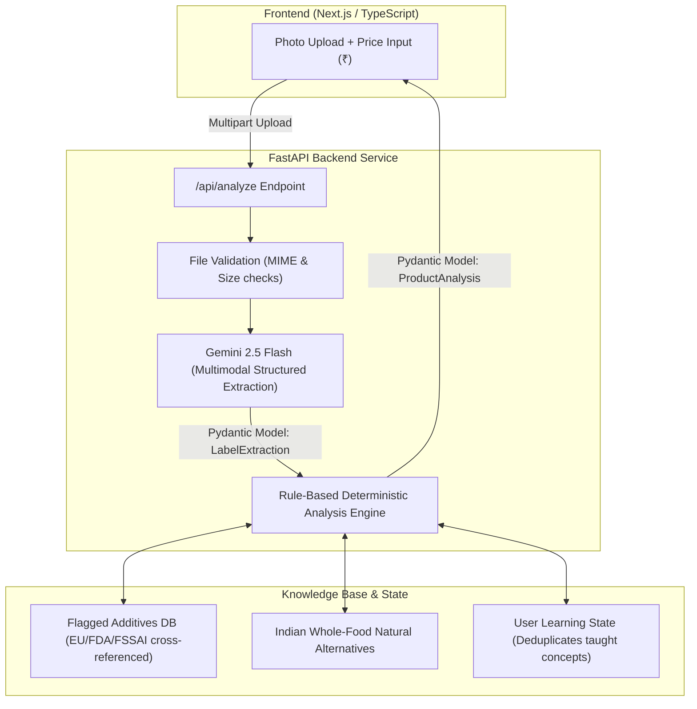

# 🔍 LabelPadho (लेबल पढ़ो)

> **Decoding Indian Packaged Food with Multimodal AI & Deterministic Nutrition Analysis.**  
> Built by a fitness-focused engineer for youth, students, and health-conscious eaters navigating misleading packaging.

---

## 💡 The Problem
In the Indian FMCG landscape, marketing deception is rampant:
1. **The "High Protein" Illusion**: "Protein chips" charging 3× price premiums for just 5g of low-grade protein per pack.
2. **The Serving Size Trap**: A 150g packet listing macros for a tiny 25g serving to hide 1,200mg sodium and 15g palm oil.
3. **Regulatory Loopholes**: Harmful additives banned or flagged in the European Union (e.g. Tartrazine INS 102, Potassium Bromate, TBHQ) remain common in Indian supermarket aisles.
4. **Whole Food Amnesia**: Consumers pay ₹150 for ultra-processed protein bars when traditional Indian foods (boiled chana, eggs, paneer, sattu) provide superior bioavailability at 1/10th the cost.

**LabelPadho** solves this by letting users snap photos of the nutrition table and ingredient list to get an instant, unvarnished breakdown.

---

## 🏗️ Architecture & Pipeline



---

## ⚡ Key Engineering Highlights (Resume Worthy)

- **Multimodal Schema-Constrained Extraction**: Directly utilized Gemini 2.5 Flash's multimodal vision capabilities bounded by a strict Pydantic `LabelExtraction` schema. Bypasses error-prone two-step OCR+LLM pipelines and preserves spatial table context across mixed Hindi/English packaging.
- **Strict Decoupling of AI & Logic**: The AI only transcribes the label into structured data. 100% of the mathematical ratios (price-per-gram-protein, serving multipliers) and regulatory risk flags are computed by a deterministic Python engine. This eliminates LLM hallucination in calculations.
- **Automated Serving Size Normalization**: Detects artificially small serving sizes and computes total-package intake reality (e.g., exposing when a snack fulfills 75% of daily sodium in one bag).
- **Personalized Nutrition Learning Engine**: Tracks topics taught to each user (e.g. sodium retention, trans-fat labeling loopholes) to avoid repetitive preaching as user nutritional literacy grows.
- **Automated Test Coverage**: Complete Pytest test suite testing edge cases (hidden trans fats, multi-serving math, additive matching) in isolation without mocking external network calls.

---

## 🛠️ Tech Stack

- **Backend**: Python 3.12+, FastAPI, Pydantic v2, pydantic-settings, Uvicorn
- **AI/LLM**: Google GenAI SDK (Gemini 2.5 Flash multimodal)
- **Validation & Math**: Pydantic, NumPy/Pandas ready
- **Testing**: Pytest
- **DevOps**: Docker, Docker Compose

---

## 🚀 Getting Started

### 1. Clone & Set Environment
```bash
git clone https://github.com/utsavgoyal/LabelPadho.git
cd LabelPadho
cp .env.example .env
```
Edit `.env` and insert your Gemini API Key:
```env
GEMINI_API_KEY=your_actual_key_here
```

### 2. Run Backend Locally
```bash
python3 -m venv .venv
source .venv/bin/activate
pip install -r backend/requirements.txt
export PYTHONPATH=backend
uvicorn app.main:app --reload --port 8000
```
Visit the interactive OpenAPI documentation at: `http://localhost:8000/docs`

### 3. Run Automated Tests
```bash
source .venv/bin/activate
export PYTHONPATH=backend
pytest backend/tests/test_analyzer.py -v
```
