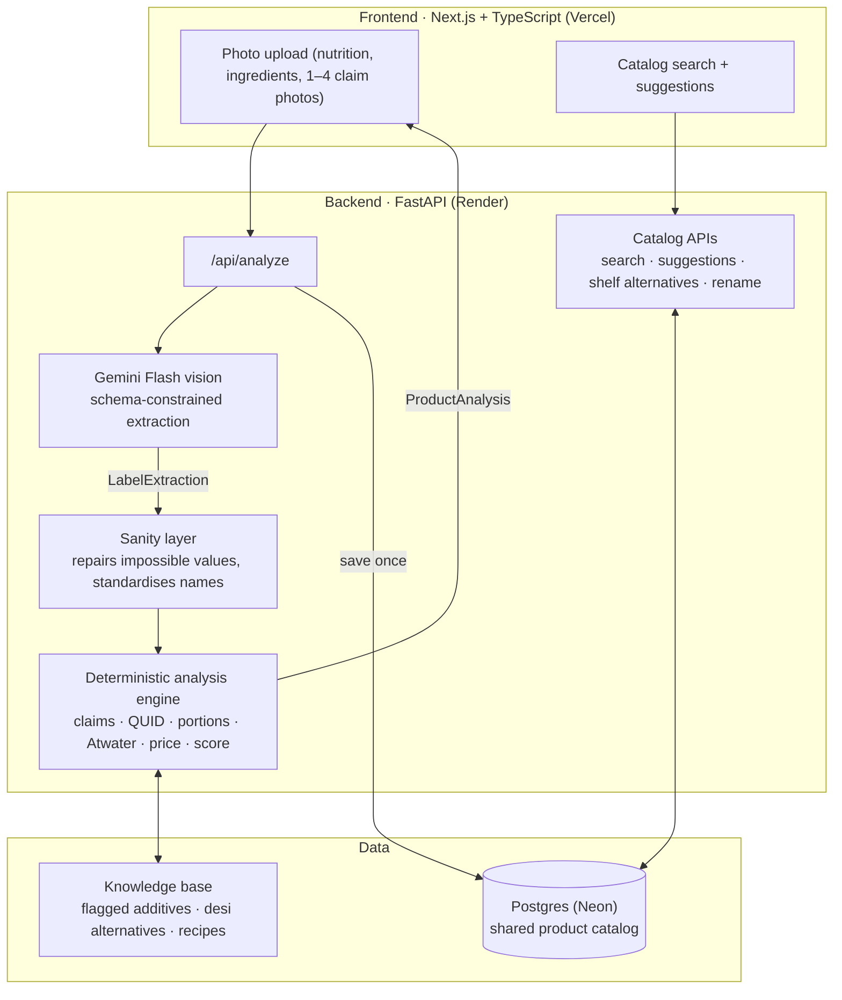

# LabelPadho (लेबल पढ़ो) — *Read the Label*

> **Snap a packaged food label. Get the truth behind the marketing in plain language.**
> Built for Indian shoppers (students, gym-goers, parents) who are tired of "High Protein", "Multigrain" and "Real Fruit" on the front contradicting the small print on the back.

**Live app:** [labelpadho.utsavgoyal.tech](https://labelpadho.utsavgoyal.tech)

---

## What it does

Take up to three kinds of photos (nutrition table, ingredients, front of pack + any claim panels) and LabelPadho returns a full audit:

| Feature | What the shopper sees | Real example |
|---|---|---|
| **Claim audit** | Every marketing claim checked against ingredients and FSSAI rules: verified, misleading or debunked | "Classic Butter" popcorn: butter is **0.16%** of the pack |
| **100% ingredient breakdown** | Donut chart of what you're actually eating, built from declared QUID % and the nutrition table | Popcorn 65%, palmolein/cottonseed oil ~29% |
| **Portion reality check** | What your real portion contains, not the brand's tiny "serving" | A 150g chips pack with a 30g serving → full pack = 1,500mg sodium |
| **Calorie math check** | Atwater formula (4/4/9 kcal per g) re-computes energy to catch rigged tables | Flags labels whose printed kcal doesn't match their macros |
| **Flagged additives** | Additives banned or restricted in the EU/US but common in India | Tartrazine (INS 102), Potassium Bromate, TBHQ |
| **Health score + shelf ranking** | 1–10 score, ranked against products **on the same shelf** | "Ranked #3 of 4 in Popcorn", with healthier options listed |
| **Value for money** | Price per gram of protein / fibre, from the MRP printed on the pack (or what you paid) | "You paid 20% below MRP" |
| **Desi swaps + home recipes** | Cheaper whole-food alternatives and quick Indian recipes in the same craving category | Roasted chana instead of a ₹150 protein bar |

### Search instead of scanning
Every product anyone scans goes into a **shared catalog**. The next person can search "bourbon", "bhujia" or "ragi chips" and open the full audit instantly, with no photos and no AI call. The search box suggests recently scanned products before you type, plus sample audits for a quick demo.

---

## How it works



1. **Gemini only transcribes.** It returns a strict Pydantic `LabelExtraction` (brand, product, variant, category, nutrition per serving *and* per 100g, ingredients with %, claims, MRP).
2. **A sanity layer fixes what can be detected.** For example, if "36g sugar per 16.7g serving" comes back, that can't fit in the serving, so it is rebuilt from the per-100g column.
3. **Plain Python does all the maths and judgement.** No LLM is involved in scores, ratios or regulatory flags, so the numbers are reproducible and unit-tested.
4. **The result is saved once** to the shared catalog and served to everyone after that.

---

## Engineering decisions worth talking about

- **AI for perception, code for judgement.** The LLM never computes a number the user sees. That removes hallucinated maths and makes the core logic testable without network calls (54 Pytest tests).
- **Self-healing extraction.** Vision models sometimes read the wrong column of a nutrition table. Physical impossibility checks (macros heavier than the serving, more than 9 kcal per gram) detect it, and the values are rebuilt from per-100g data. A missing pack weight is derived from servings × serving size.
- **A shared catalog that respects what is shared.** The **MRP** is printed on every Indian pack by law, so it is a fact about the product and is stored. **What you paid** depends on shop, city and offers, so it is used only for your own view and never saved.
- **Fixing AI mistakes without accounts.** When a scan finishes, the server returns a random **edit token** that only the scanner's browser keeps. Renaming requires that token (compared in constant time), so whoever scanned a product can fix a misread name ("Nenimems" → "Nenimemi's"), but strangers can't vandalise the shared catalog.
- **Fair comparisons.** Nine categories, each split into shelf-level sub-categories (biscuits vs chocolates vs mithai). Alternatives compare within the same shelf and fall back to the wider category only when the shelf is empty.
- **Context-aware warnings.** "The full packet has 1,500mg sodium" makes sense for chips, not for a ketchup bottle or a bag of atta. Multi-use packs (condiments, staples, dairy, packs over 400g) are judged per serving instead.
- **Clean data from messy labels.** Names are split into brand / product / variant and standardised ("BOURBON" → "Bourbon", "KTC" stays "KTC"), so search results and repeat scans line up.
- **Zero-downtime schema changes on a free stack.** A small forward-only migration adds new nullable columns to the live Postgres table at startup. It was tested against real Postgres. Alembic would be the next step with a team.

---

## Tech stack

| Layer | Tech | Hosting (all free tier) |
|---|---|---|
| Frontend | Next.js 15, React 19, TypeScript, Tailwind CSS 4 | Vercel |
| Backend | Python 3.12, FastAPI, Pydantic v2, SQLModel / SQLAlchemy | Render |
| AI | Google GenAI SDK: Gemini Flash multimodal, structured output | Gemini API |
| Database | Postgres (serverless) in production, SQLite locally | Neon |
| Quality | Pytest (unit + API tests with an in-memory DB) | — |

### API

| Method | Endpoint | Purpose |
|---|---|---|
| `POST` | `/api/analyze` | Upload label photos (+ optional price paid, portion) and get a full audit, `scan_id` and `edit_token` |
| `GET` | `/api/products/search?q=` | Multi-word search over brand, product and variant (latest audit per product) |
| `GET` | `/api/products/suggestions` | Recently scanned unique products (search dropdown) |
| `GET` | `/api/products/{id}/alternatives` | Shelf ranking and healthier products in the same sub-category |
| `GET` | `/api/history` · `/api/history/{id}` | Past scans · full saved audit |
| `PATCH` | `/api/history/{id}` | Fix brand / product / variant (requires the scanner's `edit_token`) |
| `DELETE` | `/api/history/{id}` | Remove a scan |

Interactive docs: `http://localhost:8000/docs`

---

## Run it locally

```bash
git clone https://github.com/Utsav202004/LabelPadho.git
cd LabelPadho
cp .env.example .env          # add GEMINI_API_KEY (free at aistudio.google.com)
```

**Backend**
```bash
python3 -m venv .venv && source .venv/bin/activate
pip install -r backend/requirements.txt
PYTHONPATH=backend uvicorn app.main:app --reload --port 8000
```

**Frontend**
```bash
cd frontend && npm install && npm run dev   # http://localhost:3000
```

**Tests**
```bash
cd backend && ../.venv/bin/python -m pytest -q
```

Without `DATABASE_URL`, scans go to a local SQLite file, so no setup is needed.

### Shared catalog in production (free Postgres)
Free hosts like Render wipe the disk on every deploy, so production uses Neon:
1. Create a free project at [neon.tech](https://neon.tech) and copy its connection string (**Connect** → pooled connection).
2. Add it as `DATABASE_URL` in Render → **Environment**, then redeploy.
3. Startup logs `Database initialized (hosted Postgres via DATABASE_URL)`. Tables and new columns are created automatically.

---

## Roadmap
- **Barcode scanning** for exact product matching and instant lookups
- **Crowd-sourced price reports** (price, city, date) for typical-price ranges
- **Accounts** so renames become reviewed suggestions instead of token-based edits
- **Per-100g health scoring** so small stated servings can't flatter a product
